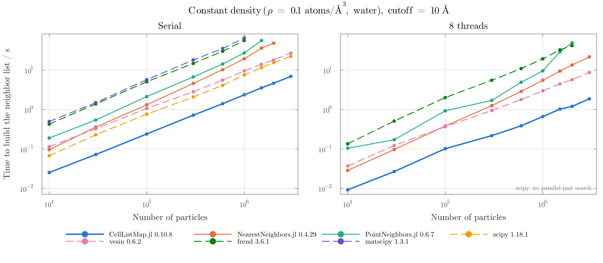
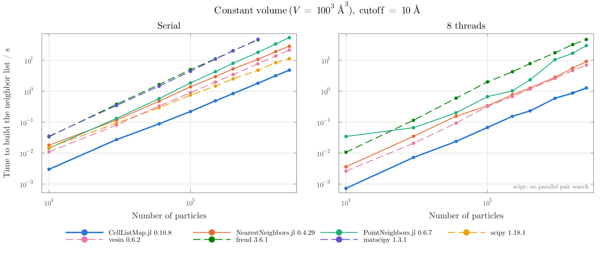

[](https://m3g.github.io/CellListMap.jl/stable)
[](https://m3g.github.io/CellListMap.jl/dev)
[](https://github.com/m3g/CellListMap.jl/actions/workflows/ci.yml?query=branch%3Amain)
[](https://codecov.io/gh/m3g/CellListMap.jl)
[](https://github.com/JuliaTesting/Aqua.jl)
[](http://juliapkgstats.com/pkg/CellListMap)

<p align=center>

</p>

# CellListMap.jl

This package is for computing interactions or any other property that is dependent on the distances between pairs of two- or three-dimensional particles, within a cutoff. It maps a function to be computed pairwise using cell lists, using periodic boundary conditions of any type. Parallel and serial implementations can be used. 

It allows the fast computation of any quantity from the pairs that are within the desired cutoff, for example pairwise potentials and forces, neighbor lists, minimum distances, an average distance or an histogram of distances, etc. This is done by passing the function to be evaluated as a parameter of the `pairwise!` function, which receives a `NeighborPair` struct for each pair.

The user guide provides direct examples of each of these applications. 

<h3>
<br>
<p align=center>
USER GUIDE: <br> 
<a href=https://m3g.github.io/CellListMap.jl>https://m3g.github.io/CellListMap.jl</a>
</p>
<br>
</h3>

## Installation

Download and install Julia for your platform from [this http url](https://julialang.org/downloads/). 
Version 1.10 or greater is required.

Install it as usual for registered Julia packages:

```julia
julia> import Pkg

julia> Pkg.add("CellListMap")
```

## Brief overview

[CellListMap.jl](https://github.com/m3g/CellListMap.jl) implements an efficient cell list scheme for the computation of interactions, neighbor lists, or any other property dependent on the distances between pairs of two- or three-dimensional particles, within a cutoff. 

The package provides an interface to compute a generic function for each pair of particles closer 
than a cutoff, using general periodic boundary conditions. Parallel and serial implementations can be used.

## Benchmarks

Time required to compute the list of all pairs of particles within a cutoff (the indices of the particles and their distance), with CellListMap's `neighborlist` function and with other popular Julia and Python packages. The particles are uniformly distributed in a periodic cubic box, and the cutoff is 10 Å. In the first figure, the density is the atomic density of water (0.1 atoms/ų), and the size of the box grows with the number of particles. In the second figure, the volume is fixed (100³ ų), so the density goes from 1/10 to 5 times that of water. Each package was run up to the system size for which a single call takes about one minute. Julia packages are shown with solid lines, and Python packages with dashed lines.





At the density of water and with 10⁶ particles, CellListMap.jl was about 3.2 times faster than the fastest serial alternative (scipy), and about 4.5 times faster than the fastest parallel alternative (vesin).

The benchmark compares the packages in the terrain for which cell lists are designed, so the following caveats apply:

- **Homogeneous systems.** Cell lists divide space into a regular grid of cells with sides of the order of the cutoff. That is ideal for homogeneous systems like the ones of this test, such as molecular systems. Tree-based methods (scipy's `cKDTree`, NearestNeighbors.jl's `KDTree`, freud's `AABBQuery`) adapt to the distribution of the points. They are the more robust choice for heterogeneous data, with clustered particles, large empty regions, or very different local densities (for example, galaxy catalogs or point clouds). Trees also support queries that cell lists do not provide, like k-nearest-neighbor searches.
- **Only the construction of a new list is measured**, including building the cell lists or trees. Other features are not compared. For example, CellListMap.jl and PointNeighbors.jl can update the cell lists between simulation steps, and PointNeighbors.jl is designed for SPH simulations and GPUs.
- **Only CPU implementations are compared.** CellListMap.jl runs on CPUs only, while PointNeighbors.jl (through KernelAbstractions.jl) and vesin also run on GPUs, which can be much faster for large systems.
- **Not every package returns the same output.** CellListMap.jl, scipy, vesin, and the NearestNeighbors.jl and PointNeighbors.jl loops described below return each pair once. freud and matscipy return each pair twice (i→j and j→i), because that is what their APIs provide.
- **NearestNeighbors.jl and PointNeighbors.jl have no function that returns a list of pairs**, so we wrote these loops ourselves. With NearestNeighbors.jl, we used `inrange!` on a `PeriodicTree`, with the minimum-image distance computed separately. With PointNeighbors.jl, we used `foreach_point_neighbor` with a `FullGridCellList` (faster than the default cell list here) and one output buffer per thread. Both are parallelized over the particles. Better implementations of these loops might exist.
- **scipy has no parallel search for pairs**: `cKDTree.query_pairs` is serial. scipy's only parallel option, `query_ball_point(..., workers=8)`, returns both copies of every pair as Python lists and was slower than the serial call, so scipy is not shown in the panels with 8 threads.
- matscipy has no parallel implementation, and freud uses its own thread pool.
- Every package used its default parameters, except for the choices described above. The times are the best of up to three runs (only one run if it took more than 5 s). The coordinates are `Float64` in every case, and Python packages receive NumPy arrays and run compiled code.
- These benchmarks were run on an Intel(R) Core(TM) i9-14900KF, with all runs restricted to the same 8 physical performance cores. We used Julia 1.13.2 and Python 3.12.3.

The scripts are available in the [`benchmarks/neighborlist_comparison`](benchmarks/neighborlist_comparison) directory.

## Citation

If you use this software and need to cite it, please use the following reference:

L. Martínez, *CellListMap.jl: Efficient and customizable cell list implementation for calculation of pairwise particle properties within a cutoff.* Computer Physics Communications, 279, 108452, 2022. https://doi.org/10.1016/j.cpc.2022.108452


