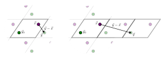

# ParticleSystem interface

## The mapped function

The purpose of CellListMap is to compute a pairwise-dependent function for all pairs of particles that are closer to
each other than a defined cutoff. This pairwise function must be implemented by the user and adhere to the following
interface:

```julia
function f(pair, output)
    (; i, j, x, y, d2, d) = pair
    # update output variable using above pair data
    return output
end
```

where `pair` is a `NeighborPair` object, containing fields `i`, `j`, `x`, `y`, `d2`, `d` and `shift`, which here we
extract from the object using [destructuring syntax](https://docs.julialang.org/en/v1/manual/functions/#Property-destructuring). 

`x` and `y` are the positions of the particles, already wrapped relative to each other according to the periodic boundary conditions (`y` is the position of the image of particle `j` within the cutoff of `x`, which is the minimum image unless the unit cell is smaller than twice the cutoff; see [Unit cell size and cutoff](@ref)), `i` and `j` are the indexes of the particles in the arrays of coordinates, `d2` is the squared distance between the particles, `d` is the distance, and `output` is the variable to be computed. 

!!! info
    #### Details of the mapped function interface

    The `pair` input of the function contains the  data that the user may use to update the `output` variable.
    The `NeighborPair` object contains fields `x`, `y`, `i`, `j`, `d2`, `shift`, and the lazily computed `d`, meaning:

    |  Input/Output |  Type   |  Meaning   |
    |:----------------:|:-------:|:-----------|
    | `x`              |  `SVector`   |  The coordinates of particle `i` of the pair.  |
    | `y`              |  `SVector`   |  The coordinates of the image of particle `j` within the cutoff of `x` (the minimum image, unless the unit cell is smaller than twice the cutoff; see [Unit cell size and cutoff](@ref)).  |
    | `i`              |  `Int`       |  Index of first particle in the original array of coordinates. |
    | `j`              |  `Int`       |  Index of second particle in the original array of coordinates. |
    | `d2`             |  `<:Real`    |  Squared distance between the particles. |
    | `d`             |  `<:Real`    |  Distance between the particles (computed lazily). |
    | `shift`          |  `SVector{N,Int}` |  Lattice translation of particle `j` relative to particle `i` (see [Unit cell size and cutoff](@ref)). |
    | `output`         |  user defined   |  the name of the variable to be updated.  |

    **Notes:** `x` and `y` may be 2D or 3D vectors, depending on the dimension of the system. The type of
    the coordinates of `x`, `y`, and of `d2` are dependent on the input arrays and cutoff, and can be `Float64`,
    `Float32`, unitful quantities, etc.

    |  Return value |  Type   |  Meaning   |
    |:----------------:|:-------:|:-----------|
    | `output`         |  user defined   |  the updated value of output.  |

    The `output` variable **must** be returned by the function, being it mutable or immutable.

The figure below illustrates the meaning of the coordinates in a `NeighborPair` object. 



Here $$\vec{x}$$ and $$\vec{y}_0$$ are the coordinates as provided by the user, which in this case fall inside the 
reference unitcell. But the image $$\vec{y}$$ of $$\vec{y}_0$$ is closer to $$\vec{x}$$. The `NeighborPair` object
will contain the coordinates `pair.x ==`$$\vec{x}$$ and `pair.y ==`$$\vec{y}$$, such that `pair.y - pair.x` will be
typically the vector used, for example, to compute the force between the particles. Also, `pair.d == norm(pair.y - pair.x)`
and corresponds to the norm of $$\vec{y} - \vec{x}$$, as represented in the first figure. 

The second figure illustrates the case of a cutoff greater than the size of the cell. Then, more than one image of 
particle `j` may be within the cutoff of particle `i`, and the same pair `(i, j)` is reported once for each of these 
images. In every case, `pair.x` is the position of particle `i` (wrapped into the unit cell), `pair.y` is the position 
of the corresponding image of particle `j`, and `pair.d` is the distance between them. A particle may also be within 
the cutoff of its own images, in which case pairs with `pair.i == pair.j` are reported (once for each pair of opposite 
images). The image is identified by `pair.shift`, and repeated pairs may occur whenever the unit cell is smaller than 
twice the cutoff (see [Unit cell size and cutoff](@ref)).

### Basic examples

For example, computing the energy, as the sum of the inverse of the distance between particles, can be done with a function like:
```@example ps_intro
using CellListMap
function energy(pair, u)
    u += 1 / pair.d
    return u
end
```

The coordinates and other properties of the system are defined with the `ParticleSystem` constructor, for example:

```@example ps_intro
system = ParticleSystem(
    positions=rand(3,10^4),
    unitcell=[1,1,1],
    cutoff=0.1,
    output=0.0,
    output_name=:energy,
)
```

The `output=0.0` defines the variable type, which can be simple scalars or any compound object. 

Finally, the `pairwise!` function applies the function `energy` to all pairs of particles whose distances are within the `cutoff`:
```@example ps_intro
u = pairwise!(energy, system)
```

Note that the `energy` function only uses `pair.d` (the distance), but all other fields (`pair.x`, `pair.y`, `pair.i`, `pair.j`, `pair.d2`) are available.

The mapped function might require additional parameters, such as the masses of the particles. In this case, we can use a closure to provide such data:

```@example ps_intro
function gravitational_energy(pair, u, masses)
    (; i, j, d)  = pair 
    u += masses[i]*masses[j] / d
    return u
end
const masses = rand(10^4) # some random masses
u = pairwise!((pair, u) -> gravitational_energy(pair, u, masses), system)
```

Here we reinforce the fact that the functions defined above compute the contribution to the energy of the interaction of *a single* pair of particles. This function will be called for every pair of particles within the cutoff, automatically, in the `pairwise!` call.

!!! note
    The `output` of the `CellListMap` computation may be of any kind. Most commonly, it is an energy, a set of forces, or other data type that can be represented either as a number, an array of numbers, or an array of vectors (`SVectors` in particular), such as an arrays of forces.

    Additionally, the properties are frequently additive (the energy is the sum of the energy of the particles, or the forces are added by summation).

    For these types of `output` data the usage does not require the implementation of any data-type dependent function.

## The ParticleSystem constructor

The `ParticleSystem` constructor receives the properties of the system and sets up automatically all the data structures needed for the `pairwise!` computation.

### Input parameters

| Keyword | Type | Default | Description |
|:--------|:-----|:-------:|:------------|
| `positions` / `xpositions` | `AbstractVector` or `AbstractMatrix` | — (required) | Coordinates of the (first) set of particles. `positions` is an alias for `xpositions` for single-set computations. Accepts a `Vector{SVector}`, a vector of plain vectors, or a `(D, N)` matrix. |
| `ypositions` | `AbstractVector`, `AbstractMatrix`, or `Nothing` | `nothing` | Coordinates of the second set of particles. If provided, the `pairwise!` function will iterate over all cross-pairs between the two sets. |
| `cutoff` | `Number` | — (required) | Cutoff distance. Only pairs within this distance contribute to the output. |
| `unitcell` | vector, matrix, or `Nothing` | `nothing` | Unit cell for periodic boundary conditions. A vector of sides defines an orthorhombic cell (faster); a matrix defines a triclinic cell (columns are lattice vectors). `nothing` means non-periodic. |
| `output` | any | — (required) | Initial value of the output variable. Determines the type of the result; typically `0.0` for a scalar, or a pre-allocated array for forces. |
| `output_name` | `Symbol` | `:output` | Name used to access the output from the system: `system.energy` if `output_name=:energy`. |
| `parallel` | `Bool` | `true` | Enable multi-threading. |
| `nbatches` | `Tuple{Int,Int}` | `(0,0)` | Number of batches for parallelization (see [Fine control of the parallelization](@ref Fine-control-of-the-parallelization)). |

!!! note
    - Systems can be 2 or 3-dimensional.
    - `Unitful` quantities are supported when appropriate unit types are provided for all input parameters.

After construction, use [`update!`](@ref) to change coordinates, cutoff, unit cell, or parallelization between `pairwise!` calls. See the [Updating the system](@ref) section for details.

### Properties

The following properties of a `ParticleSystem` object can be read using dot notation:

| Property | Description |
|:---------|:------------|
| `xpositions` | Coordinates of the first (or only) set of particles, as a vector of `SVector`s. It can be mutated in place (see below). |
| `positions` | Alias for `xpositions`. |
| `ypositions` | Coordinates of the second set of particles (two-set systems only). It can be mutated in place (see below). |
| `cutoff` | Current cutoff distance. |
| `unitcell` | Current unit cell, as a matrix. |
| `parallel` | Whether multi-threading is enabled. |
| `output` | The output variable of the computation. |
| `OutputName` | Alias for `output` using the name given in `output_name`. For example, `sys.energy` if `output_name=:energy`. |

The cutoff, the unit cell, and the parallelization flag are modified with the [`update!`](@ref)
function (see [Updating the system](@ref)).

The position arrays can be mutated in place, and also resized, with the usual array
operations. The elements must be `SVector`s:

- `sys.xpositions[i] = SVector(...)` sets the position of one particle;
- `sys.xpositions .= x` copies the positions of a vector `x` of the same length;
- `push!`, `append!`, `resize!` and `empty!` change the number of particles.

Any of these marks the cell lists as outdated, and they are rebuilt automatically in the next
call to `pairwise!`. To replace the positions by an array of any of the supported input types
(for example a `(D,N)` matrix), with any number of particles, use [`update!`](@ref).

!!! warning
    If the number of particles changes, an `output` that depends on the number of particles
    (for example, an array of forces) must be resized accordingly with `resize_output!`.
    See [Updating coordinates](@ref).

For example, using the system defined in the example above:

```@example ps_intro
system.energy # access output by its name
```

```@example ps_intro
system.cutoff # read current cutoff
```

```@example ps_intro
system.unitcell # read current unit cell
```

The cutoff, unit cell, and parallelization flag are modified with `update!`:

```@example ps_intro
update!(system; cutoff = 0.2, unitcell = [2, 2, 2], parallel = false)
system
```
